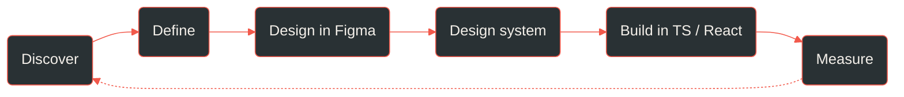

<a href="https://raphaclucena.com.br/en">
  <picture>
    <source media="(prefers-color-scheme: dark)" srcset="./assets/header-dark.svg">
    
  </picture>
</a>

<p>
  <a href="https://raphaclucena.com.br/en"></a>
  <a href="https://www.linkedin.com/in/raphaclucena/?locale=en-US"></a>
  <a href="https://www.behance.net/raphaclucena"></a>
  <a href="mailto:oi@raphaclucena.com.br"></a>
  
</p>

I design and build digital products end to end: discovery, interface, design system and the code that ships it.

10+ years between web, teaching and visual production taught me one habit: learn something deep enough to teach it, then turn it into something people actually use. Today that means **product design with real code behind it**, and **AI built into the product**, not bolted on.

```ts
const rapha = {
  role: ["Product Designer", "AI Product Builder"],
  based: "Sorocaba, SP · Brazil (UTC-3)",
  openTo: { roles: ["Product Design", "Design Engineering", "AI products"], work: "remote | hybrid" },

  designs: ["discovery", "UX/UI", "design systems", "prototyping", "motion"],
  builds: {
    frontend: ["HTML", "CSS", "JavaScript", "TypeScript", "React", "Next.js", "Astro"],
    backend: ["Node.js", "PHP", "SQL", "Supabase"],
    ai: ["LLM features in product", "agentic workflows", "Claude Code", "MCP"],
  },

  background: [
    "web design & dev: intern to head of web",
    "UX/UI teacher: 1,000+ students",
    "VFX artist: 21 IMDb credits",
    "growth designer: B2B SaaS rebrand",
  ],
  motto: "from sketch to code.",
} as const;
```

## How I work



AI sits inside every step: research synthesis, fast prototypes, code pairing and the product features themselves.

## Toolbox

**Design**<br>


**Front-end**<br>


**Back-end & data**<br>


**Ship & organize**<br>


**AI**<br>


## Featured work

**[Elephan.ai](https://raphaclucena.com.br/en/projects/elephan)** · B2B SaaS, growth design<br>
Discovery with leadership, a new brand, a site split by audience and built for search and AI answers, plus three event apps (diagnosis, gamified demo, NFC contacts).<br>
`~2.5× time on site` `4 months from discovery to launch` · Figma · Framer · React · Node.js · Vercel

**[Vulkanprint](https://raphaclucena.com.br/en/projects/vulkanprint)** · 3D printing studio, brand + product + site<br>
Catalog organized by occasion instead of material, quotes that start from an idea or a photo, and an "Ask an AI" block that opens ChatGPT, Claude or Gemini with the right question.<br>
`shipped in 1 month` `PageSpeed mobile 94 · 96 · 100 · 100` · Figma · Affinity · Next.js

**[Ranguear](https://raphaclucena.com.br/en/projects/ranguear)** · Mobile app, solo project<br>
Helps people decide what to eat with a weighted draw from their own places and favorites. Offline first, data stays on the device. Brand, UX and code by me.<br>
`tested with 5 users` `coming to the stores`

**[raphaclucena.com.br](https://raphaclucena.com.br/en)** · My portfolio, treated as a product<br>
Built in Astro on top of [its own design system](https://raphaclucena.com.br/design-system), trilingual (PT · EN · ES), light and dark themes.

## Always learning

Alura tracks in **AI Product Design**, **AI Product Builder**, **UX Design**, **UI Design**, **Front-end React** and **Leadership** ([profile](https://cursos.alura.com.br/app/user/raphaclucena)). Going deeper right now on TypeScript, design systems, GSAP and web performance.

## Off screen

Guitar and music, 3D, illustration, and a past life in VFX for film and series (*Senna*, *Sintonia*, *DNA do Crime*). I also run [Hibard](https://hibard.studio), my one-person creative studio.

<details>
<summary><b>🇧🇷 Versão em português</b></summary>
<br>

Eu desenho e construo produtos digitais de ponta a ponta: descoberta, interface, design system e o código que coloca tudo no ar.

Mais de 10 anos entre web, sala de aula e produção visual me deram um hábito: aprender algo a fundo a ponto de ensinar, e depois transformar isso em algo que as pessoas usam de verdade. Hoje isso quer dizer **product design com código de verdade por trás** e **IA dentro do produto**, não colada por cima.

- **Product Designer & AI Product Builder** em Sorocaba, SP. Aberto a vagas remotas ou híbridas.
- **Design:** descoberta, UX/UI, design systems, protótipos e motion.
- **Código:** HTML, CSS, JavaScript, TypeScript, React, Next.js, Astro, Node.js, PHP, SQL e Supabase.
- **IA:** recursos com LLM dentro do produto, fluxos com agentes, Claude Code e MCP.
- **Trajetória:** web (de estagiário a head of web), professor de UX/UI com mais de 1.000 alunos, artista de VFX com 21 créditos no IMDb e growth designer em SaaS B2B.

Cases completos em [raphaclucena.com.br](https://raphaclucena.com.br/projetos). Contato: [oi@raphaclucena.com.br](mailto:oi@raphaclucena.com.br)

</details>

<br>

<sub>from sketch to code. · <a href="https://raphaclucena.com.br/en">raphaclucena.com.br</a></sub>
