<a href="https://raphaclucena.com.br">
  
</a>

  
  
  
  
  

<h3 align="center">Transformo ideias confusas em produtos claros, do primeiro esboço ao código que vai pro ar.</h3>

 



  <a href="https://raphaclucena.com.br/projetos/elephan"></a>
  <a href="https://raphaclucena.com.br/projetos/vulkanprint"></a>

  <a href="https://raphaclucena.com.br/projetos/ranguear"></a>
  <a href="https://raphaclucena.com.br/design-system"></a>








**Oi, eu sou o Rapha.** Product designer com caixa de ferramentas de quem constrói. Gosto de cuidar do ciclo inteiro: conversar com as pessoas, enquadrar o problema, desenhar no Figma, transformar em design system e colocar no ar em TypeScript.

Cheguei aqui pelo caminho longo. Mais de 10 anos entre web, sala de aula e VFX para cinema me deram um hábito: aprender algo a fundo a ponto de ensinar, e depois transformar isso em algo que as pessoas usam de verdade. Hoje aponto esse hábito para produtos com IA dentro, onde design e engenharia não se separam.

**Como trabalho.** Todo projeto passa pelo mesmo ciclo. Começa nas pessoas e termina num número, e o que esse número ensina abre a próxima rodada. A IA trabalha dentro de cada etapa, não como uma etapa à parte: síntese de pesquisa, protótipos, código em dupla e o próprio produto.

**Sempre estudante.** Ensinar mais de 1.000 pessoas me deixou estudante para sempre. Agora estou nas trilhas da Alura de AI Product Design, AI Product Builder, UX Design, UI Design, Front-end React e Liderança ([perfil](https://cursos.alura.com.br/app/user/raphaclucena)), e me aprofundando em TypeScript, design systems, GSAP e performance web.

**Fora da tela.** Quando não estou desenhando ou programando, estou tocando guitarra, modelando em 3D ou desenhando. Antes de produto, passei anos fazendo VFX para cinema e séries como *Senna*, *Sintonia* e *DNA do Crime*. Foi lá que aprendi a cuidar do quadro que ninguém percebe. Também toco a [Hibard](https://hibard.studio), meu estúdio criativo de uma pessoa só.

<b>🇺🇸 Read in English</b>

 

**I turn messy ideas into clear products, from the first sketch to the code that ships.**

**Hi, I'm Rapha.** A product designer with a builder's toolbox. I like owning the whole loop: talking to people, framing the problem, designing it in Figma, turning it into a design system and shipping it in TypeScript.

I got here the long way. 10+ years across web, classrooms and film VFX taught me one habit: learn something deep enough to teach it, then turn it into something people actually use. Today I point that habit at products with AI inside, where design and engineering can't be pulled apart.

**Featured work.** [Elephan.ai](https://raphaclucena.com.br/en/projects/elephan): B2B SaaS rebrand, 2.5x time on site. [Vulkanprint](https://raphaclucena.com.br/en/projects/vulkanprint): 3D printing studio, 1 month from brief to launch. [Ranguear](https://raphaclucena.com.br/en/projects/ranguear): mobile app, tested with 5 people before launch. And my own [portfolio](https://raphaclucena.com.br/en), built on its own [design system](https://raphaclucena.com.br/en/design-system).

**How I work.** Every project runs through the same loop: discover, define, design in Figma, design system, build in TS / React, measure. It starts with people and ends with a number, and what the number teaches starts the next round. AI works inside each step, not as a step of its own.

**Still a student.** Teaching 1,000+ people made me a permanent student. Right now I'm working through Alura tracks in AI Product Design, AI Product Builder, UX Design, UI Design, Front-end React and Leadership, and going deeper on TypeScript, design systems, GSAP and web performance.

**Beyond the screen.** Guitar, 3D and drawing. Before product, I spent years in VFX for film and series like *Senna*, *Sintonia* and *DNA do Crime*, where I learned to care about the frame nobody notices. I also run [Hibard](https://hibard.studio), my one-person creative studio.

Open to remote or hybrid roles. Let's talk: [oi@raphaclucena.com.br](mailto:oi@raphaclucena.com.br) · [LinkedIn (EN)](https://www.linkedin.com/in/raphaclucena/?locale=en-US)

 

  <a href="https://raphaclucena.com.br">raphaclucena.com.br</a> ·
  <a href="https://www.linkedin.com/in/raphaclucena/">LinkedIn</a> ·
  <a href="https://www.behance.net/raphaclucena">Behance</a> ·
  <a href="mailto:oi@raphaclucena.com.br">oi@raphaclucena.com.br</a>

